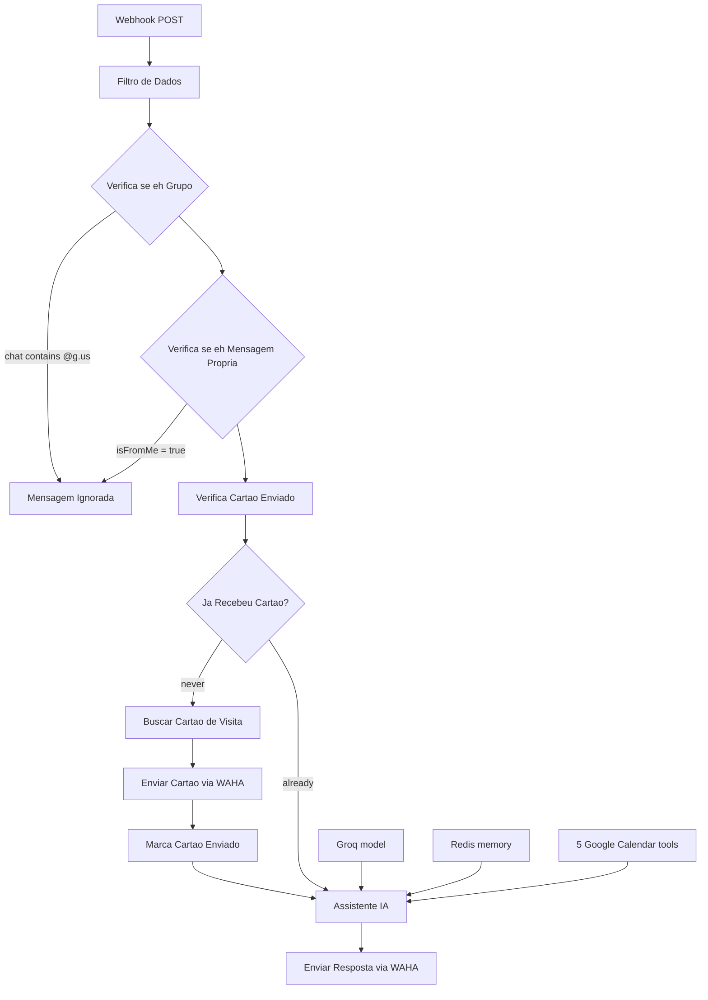

# WhatsApp AI Scheduling Assistant

An n8n workflow that turns WhatsApp into an AI-powered front desk. Messages
come in through WAHA, useless ones are filtered out, new customers receive
the company business card once, and everything else is handled by *Nero*, a
Groq-powered agent that answers questions, triages contacts and manages
Google Calendar appointments.

Built by **EAR Automação**.

## What it does

- Receives WhatsApp messages via a WAHA webhook (POST) and normalizes them.
- Drops group messages and the bot's own messages (no echo loops).
- Sends a business-card image **exactly once** per customer (Postgres +
  Redis flag without TTL).
- Hands the conversation to an AI agent (*Nero*) with 1-hour Redis memory,
  a 15-message context window and 5 Google Calendar tools
  (create / list / get / update / delete).
- Replies through WAHA `sendText`, with `JSON.stringify` bodies so
  multi-line answers never break the request.

## Flow

Full details: [docs/architecture.md](docs/architecture.md).

## Stack and prerequisites

| Component | Role | Minimum version |
| --- | --- | --- |
| n8n | Workflow engine | not verified |
| WAHA | WhatsApp HTTP API | not verified |
| Groq (`openai/gpt-oss-120b`) | Chat model | not verified |
| Redis | Conversation memory + card flag | not verified |
| PostgreSQL | `cartao_visita` table (card image) | not verified |
| Google Calendar (OAuth2) | Appointments | not verified |

Python 3 (standard library only) is used by the repository scripts.

## Quick start

1. Clone the repository.
2. Create the Postgres table: `psql -d <db> -f sql/001_create_cartao_visita.sql`
   and insert your card (see the SQL file for the base64 recipe).
3. Start a Redis instance reachable from n8n.
4. Configure WAHA (webhook, session, API key) —
   [docs/waha-configuration.md](docs/waha-configuration.md).
5. Import [`workflows/whatsapp-ai-scheduling-assistant.json`](workflows/whatsapp-ai-scheduling-assistant.json)
   into n8n (*Workflows → Import from File*).
6. Create and attach the 5 credentials — [docs/credentials.md](docs/credentials.md).
7. Replace the placeholders: `https://YOUR-WAHA-HOST`,
   `replace-with-a-long-random-path`, `YOUR_CALENDAR_ID` —
   [docs/setup-guide.md](docs/setup-guide.md).
8. Activate the workflow, point WAHA at
   `https://<n8n-host>/webhook/<your-path>` and test —
   [docs/testing.md](docs/testing.md).

## Credentials at a glance

| Credential | Nodes | Guide |
| --- | --- | --- |
| Groq API | Modelo de Linguagem (Groq) | [docs/credentials.md](docs/credentials.md) |
| Redis | memory + both card nodes | [docs/credentials.md](docs/credentials.md) |
| Postgres | Buscar Cartão de Visita | [docs/credentials.md](docs/credentials.md) |
| Google Calendar OAuth2 | 5 calendar tools | [docs/google-calendar-setup.md](docs/google-calendar-setup.md) |
| Header Auth (WAHA) | both WAHA HTTP nodes | [docs/waha-configuration.md](docs/waha-configuration.md) |

The export contains **no credentials** — create them in n8n after importing.

## How it works

1. `Webhook` receives the WAHA event on a long random path.
2. `Filtro de Dados` flattens `pushName`, `senderAlt`, `body`, `isFromMe`,
   `session`, `chat`, `type`, `hasMedia`, …
3. `Verifica se é Grupo` discards `@g.us` chats; `Verifica se é Mensagem
   Própria` discards `isFromMe = true` (both end in `Mensagem Ignorada`).
4. `Verifica Cartão Enviado` reads `cartao_enviado:<senderAlt>` in Redis.
   Empty → `Buscar Cartão de Visita` (Postgres, latest row) → `sendImage` →
   `Marca Cartão Enviado` → agent. Not empty → agent directly.
5. `Assistente IA` answers with Groq + Redis memory + the 5 calendar tools.
6. `Enviar Resposta via WAHA` posts the answer with `sendText`.

## Agent behavior

The system prompt ([prompts/nero-system-prompt.md](prompts/nero-system-prompt.md))
defines Nero:

- **Answer before asking** — never replies with a generic "how can I help?"
  when the customer already asked something concrete.
- **Never repeats itself** — reads the Redis history and does not resend
  greetings or questions.
- **Triages only when the intent is unclear**, one question at a time.
- **Formal, concise pt-BR tone**; honest about prices/deadlines it does not
  know.
- **Uses Google Calendar only when scheduling makes sense**, collecting
  title/customer/date/start/end first, and only confirms success when the
  tool reports success (times are described with `TZ -03:00`).

## Known limitations

- Voice notes arrive with an empty `body` — no transcription yet
  ([docs/roadmap.md](docs/roadmap.md)).
- The webhook has no authentication beyond the random path
  ([docs/troubleshooting.md](docs/troubleshooting.md)).
- Groq's free tier is rate-limited; peaks can cause temporary failures, and
  each tool call costs a second model call.
- A Redis failure on the card nodes can cause the card to be sent again
  (the conversation itself keeps working).
- The `-03:00` timezone is baked into the calendar tool descriptions.

## Security

- The export is sanitized: no credentials, no webhook id, no real URLs,
  e-mails or phone numbers. `scripts/sanitize_workflow.py` produces the safe
  version from a raw export; `scripts/validate_workflow.py` (also run by CI)
  fails on any secret.
- Raw exports (`*.raw.json`, `*-export.json`) and `.env` are git-ignored.
- Report vulnerabilities privately as described in
  [SECURITY.md](SECURITY.md).

## Roadmap

Audio handling, webhook header authentication, voice replies and automated
flow tests are **planned, not implemented** — see
[docs/roadmap.md](docs/roadmap.md).

## Contributing

Issues and pull requests are welcome. Read
[CONTRIBUTING.md](CONTRIBUTING.md) first — especially the rule that raw n8n
exports must pass `scripts/sanitize_workflow.py` before being committed.

## License

[MIT](LICENSE) © EAR Automação.

---

Português: [README.pt-BR.md](README.pt-BR.md)
