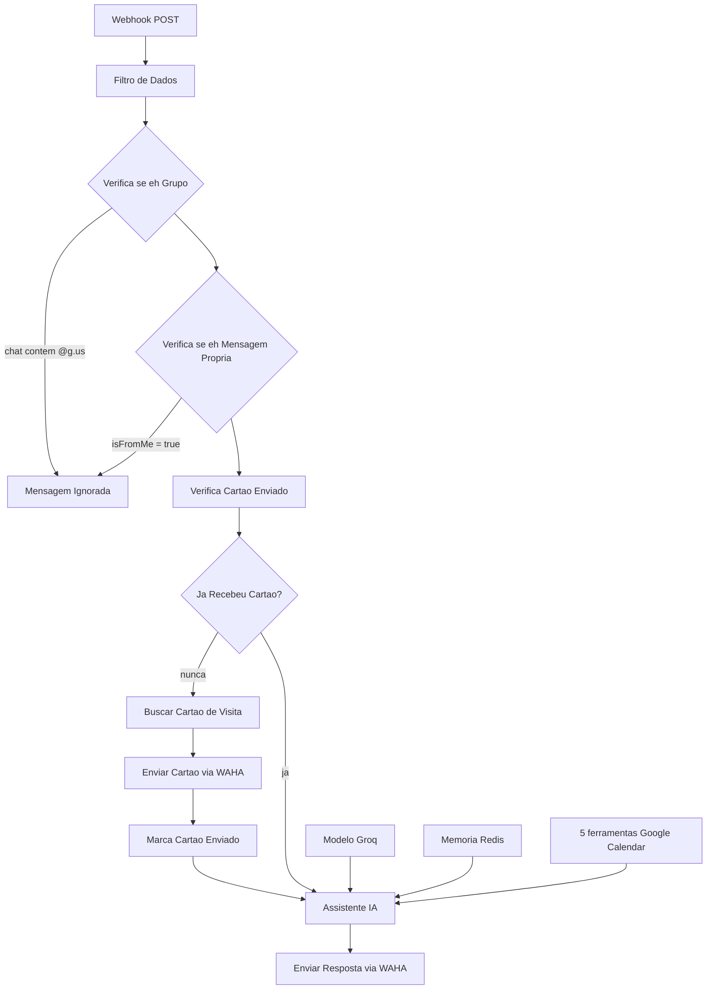

# Assistente de IA de Agendamento para WhatsApp

Um workflow n8n que transforma o WhatsApp em um front desk com IA. As
mensagens chegam pelo webhook da WAHA, as inúteis são filtradas, novos
clientes recebem o cartão de visita da empresa uma única vez e todo o resto é
tratado por *Nero*, um agente com Groq que responde dúvidas, faz triagem e
gerencia compromissos no Google Calendar.

Desenvolvido pela **EAR Automação**.

## O que ele faz

- Recebe mensagens do WhatsApp via webhook da WAHA (POST) e normaliza os
  campos.
- Descarta mensagens de grupo e as mensagens do próprio bot (sem eco).
- Envia a imagem do cartão de visita **uma única vez** por cliente (Postgres +
  chave Redis sem TTL).
- Entrega a conversa a um agente de IA (*Nero*) com memória Redis de 1 hora,
  janela de 15 mensagens e 5 ferramentas do Google Calendar
  (criar / listar / buscar / atualizar / cancelar).
- Responde pela WAHA com `sendText` e corpos montados via `JSON.stringify`,
  para respostas multilinha nunca quebrarem a requisição.

## Fluxo

Detalhes completos: [docs/architecture.md](docs/architecture.md).

## Stack e pré-requisitos

| Componente | Função | Versão mínima |
| --- | --- | --- |
| n8n | Motor do workflow | não verificado |
| WAHA | WhatsApp HTTP API | não verificado |
| Groq (`openai/gpt-oss-120b`) | Modelo de chat | não verificado |
| Redis | Memória de conversa + flag do cartão | não verificado |
| PostgreSQL | Tabela `cartao_visita` (imagem do cartão) | não verificado |
| Google Calendar (OAuth2) | Agendamentos | não verificado |

Python 3 (somente biblioteca padrão) é usado pelos scripts do repositório.

## Início rápido

1. Clone o repositório.
2. Crie a tabela no Postgres:
   `psql -d <db> -f sql/001_create_cartao_visita.sql` e insira seu cartão
   (o próprio arquivo explica a receita do base64).
3. Suba um Redis acessível pelo n8n.
4. Configure a WAHA (webhook, sessão, chave de API) —
   [docs/waha-configuration.md](docs/waha-configuration.md).
5. Importe
   [`workflows/whatsapp-ai-scheduling-assistant.json`](workflows/whatsapp-ai-scheduling-assistant.json)
   no n8n (*Workflows → Import from File*).
6. Crie e vincule as 5 credenciais — [docs/credentials.md](docs/credentials.md).
7. Troque os placeholders: `https://YOUR-WAHA-HOST`,
   `replace-with-a-long-random-path`, `YOUR_CALENDAR_ID` —
   [docs/setup-guide.md](docs/setup-guide.md).
8. Ative o workflow, aponte a WAHA para
   `https://<n8n-host>/webhook/<seu-caminho>` e teste —
   [docs/testing.md](docs/testing.md).

## Credenciais em resumo

| Credencial | Nós | Guia |
| --- | --- | --- |
| Groq API | Modelo de Linguagem (Groq) | [docs/credentials.md](docs/credentials.md) |
| Redis | memória + os dois nós do cartão | [docs/credentials.md](docs/credentials.md) |
| Postgres | Buscar Cartão de Visita | [docs/credentials.md](docs/credentials.md) |
| Google Calendar OAuth2 | as 5 ferramentas de calendário | [docs/google-calendar-setup.md](docs/google-calendar-setup.md) |
| Header Auth (WAHA) | os dois nós HTTP da WAHA | [docs/waha-configuration.md](docs/waha-configuration.md) |

A exportação **não contém credenciais** — crie-as no n8n após importar.

## Como funciona

1. `Webhook` recebe o evento da WAHA em um caminho longo e aleatório.
2. `Filtro de Dados` extrai `pushName`, `senderAlt`, `body`, `isFromMe`,
   `session`, `chat`, `type`, `hasMedia`, …
3. `Verifica se é Grupo` descarta chats `@g.us`; `Verifica se é Mensagem
   Própria` descarta `isFromMe = true` (ambos terminam em
   `Mensagem Ignorada`).
4. `Verifica Cartão Enviado` lê `cartao_enviado:<senderAlt>` no Redis.
   Vazio → `Buscar Cartão de Visita` (Postgres, registro mais recente) →
   `sendImage` → `Marca Cartão Enviado` → agente. Não vazio → agente direto.
5. `Assistente IA` responde com Groq + memória Redis + as 5 ferramentas de
   calendário.
6. `Enviar Resposta via WAHA` publica a resposta com `sendText`.

## Comportamento do agente

O system prompt ([prompts/nero-system-prompt.md](prompts/nero-system-prompt.md))
define o Nero:

- **Responde antes de perguntar** — nunca devolve um "como posso ajudar?"
  genérico quando o cliente já fez uma pergunta concreta.
- **Nunca se repete** — lê o histórico do Redis e não reenvia saudações ou
  perguntas já feitas.
- **Faz triagem só quando a intenção não está clara**, uma pergunta por vez.
- **Tom formal, objetivo, em pt-BR**; honesto sobre preços/prazos que não
  domina.
- **Usa o Google Calendar só quando faz sentido**, coletando
  título/cliente/data/início/fim antes, e só confirma o agendamento se a
  ferramenta retornar sucesso (horários descritos com `TZ -03:00`).

## Limitações conhecidas

- Mensagens de voz chegam com `body` vazio — ainda sem transcrição
  ([docs/roadmap.md](docs/roadmap.md)).
- O webhook não tem autenticação além do caminho aleatório
  ([docs/troubleshooting.md](docs/troubleshooting.md)).
- O plano gratuito da Groq tem limite de taxa; picos podem causar falhas
  temporárias e cada chamada de ferramenta gera uma segunda chamada ao modelo.
- Se o Redis falhar nos nós do cartão, o cartão pode ser reenviado (a
  conversa continua funcionando).
- O fuso `-03:00` está embutido nas descrições das ferramentas de calendário.

## Segurança

- A exportação é sanitizada: sem credenciais, sem webhookId, sem URLs reais,
  e-mails ou telefones. `scripts/sanitize_workflow.py` gera a versão segura a
  partir de um export bruto; `scripts/validate_workflow.py` (também rodado no
  CI) falha em qualquer segredo.
- Exports brutos (`*.raw.json`, `*-export.json`) e `.env` estão no
  `.gitignore`.
- Reporte vulnerabilidades de forma privada como descrito em
  [SECURITY.md](SECURITY.md).

## Roadmap

Tratamento de áudio, autenticação do webhook por header, resposta em áudio e
testes automatizados do fluxo estão **planejados, não implementados** — veja
[docs/roadmap.md](docs/roadmap.md).

## Contribuição

Issues e pull requests são bem-vindos. Leia primeiro
[CONTRIBUTING.md](CONTRIBUTING.md) — em especial a regra de que exports brutos
do n8n precisam passar por `scripts/sanitize_workflow.py` antes de serem
commitados.

## Licença

[MIT](LICENSE) © EAR Automação.

---

English: [README.md](README.md)
