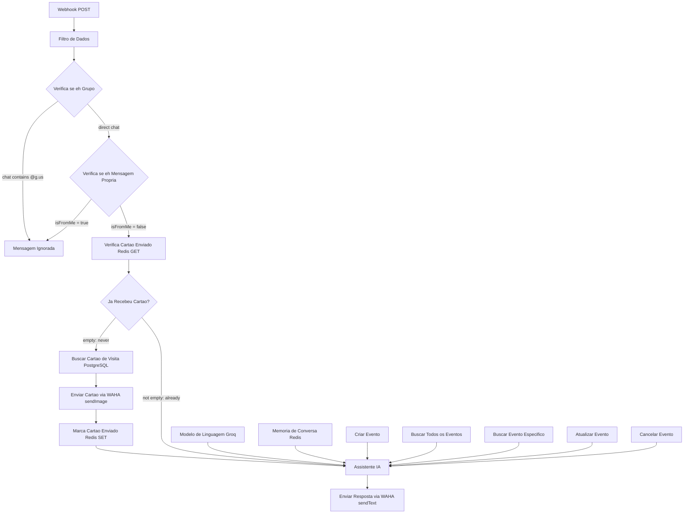

# Architecture

How the `whatsapp-ai-scheduling-assistant` n8n workflow is put together:
message flow, node inventory and the decisions behind them.

- Source of truth: [`workflows/whatsapp-ai-scheduling-assistant.json`](../workflows/whatsapp-ai-scheduling-assistant.json)
- 19 nodes, 5 Google Calendar tools, 3 external services (WAHA, Groq,
  Redis/PostgreSQL/Google Calendar behind n8n credentials)

## Flow

A diagram focusing on the same flow with the auxiliary resources grouped is
also available as a static page: [architecture.html](architecture.html).

## Node inventory

| # | Node | Type | Function | Input | Output | Error handling |
| --- | --- | --- | --- | --- | --- | --- |
| 1 | Webhook | `webhook` | Receives WAHA POST events on a long random path | HTTP POST | raw payload | n8n default |
| 2 | Filtro de Dados | `set` | Normalizes `pushName`, `senderAlt`, `body`, `isFromMe`, `session`, `chat`, `type`, `hasMedia`, `ack`, `meuLid`, `telefoneLimpo`, … | webhook payload | flat field list | n8n default |
| 3 | Verifica se é Grupo | `if` | Discards group chats (`chat` contains `@g.us`) | normalized fields | `true` → ignore, `false` → next | n8n default |
| 4 | Verifica se é Mensagem Própria | `if` | Discards the bot's own messages (`isFromMe = true`) to avoid echo loops | normalized fields | `true` → ignore, `false` → next | n8n default |
| 5 | Mensagem Ignorada | `noOp` | End of the line for filtered messages | any | passthrough | n8n default |
| 6 | Verifica Cartão Enviado | `redis` | `GET cartao_enviado:<senderAlt>` | normalized fields | `cartaoEnviado` | `onError: continueRegularOutput` |
| 7 | Já Recebeu Cartão? | `if` | Empty value → customer never got the card | Redis result | `true` (empty) → send card, `false` → agent | n8n default |
| 8 | Buscar Cartão de Visita | `postgres` | `SELECT imagem_base64, mimetype, filename, legenda … ORDER BY id DESC LIMIT 1` | — | card row | `retryOnFail` + `onError: continueRegularOutput` |
| 9 | Enviar Cartão via WAHA | `httpRequest` | `POST /api/sendImage` with base64 image + caption | Postgres row + `Filtro de Dados` | WAHA response | `onError: continueRegularOutput` |
| 10 | Marca Cartão Enviado | `redis` | `SET cartao_enviado:<senderAlt> = 1` (no TTL) | `Filtro de Dados` | Redis reply | `retryOnFail` + `onError: continueRegularOutput` |
| 11 | Assistente IA | `agent` | Nero: answers, triages, drives the calendar tools | user prompt + system prompt + memory | `output` text | n8n default |
| 12 | Modelo de Linguagem (Groq) | `lmChatGroq` | `openai/gpt-oss-120b` chat model | Groq credential | model connection (`ai_languageModel`) | n8n default |
| 13 | Memória de Conversa (Redis) | `memoryRedisChat` | Session per `senderAlt`, TTL 1 h, 15-message window | Redis credential | memory connection (`ai_memory`) | n8n default |
| 14 | Criar Evento | `googleCalendarTool` | Creates an event (`$fromAI` title/description/start/end, TZ −03:00) | agent tool call | event id | n8n default |
| 15 | Buscar Todos os Eventos | `googleCalendarTool` | Lists events ordered by `startTime` | agent tool call | event list | n8n default |
| 16 | Buscar Evento Específico | `googleCalendarTool` | Fetches one event by id | agent tool call | event | n8n default |
| 17 | Atualizar Evento | `googleCalendarTool` | Updates title/description/start/end of an event | agent tool call | event | n8n default |
| 18 | Cancelar Evento | `googleCalendarTool` | Deletes an event by id | agent tool call | deletion result | n8n default |
| 19 | Enviar Resposta via WAHA | `httpRequest` | `POST /api/sendText` with the agent's answer | agent `output` | WAHA response | n8n default |

Error handling: `continueRegularOutput` keeps the execution flowing when a
node fails, returning an empty/errored item instead of stopping the workflow.
It is used only on the business-card path (nodes 6, 8, 9, 10) so that a Redis
or PostgreSQL outage never blocks the conversation. Nodes 8 (`Buscar Cartão de
Visita`) and 10 (`Marca Cartão Enviado`) additionally set `retryOnFail`, so a
transient Postgres/Redis error is retried before the fallback kicks in.

## Design decisions

### Group and echo filters first
WAHA forwards both direct and group messages, and it also re-emits the
messages the bot itself sends (`isFromMe = true`). Filtering `@g.us` chats
(node 3) and own messages (node 4) before any I/O prevents the assistant from
replying inside groups and, more importantly, from looping forever on its own
output.

### Business card sent exactly once
The Redis key `cartao_enviado:<senderAlt>` is written **without a TTL**
(`Marca Cartão Enviado`), so a customer never receives the card twice, even
weeks later. The check is a `GET` + IF instead of a flag in Postgres so that
no schema change is needed to control deliveries.

### Conversation memory scoped by `senderAlt`
`Memória de Conversa (Redis)` uses `senderAlt` (the WhatsApp id, e.g.
`5500000000000@c.us`) as the session key, with a 1-hour TTL and a 15-message
window. Conversations are therefore per-customer and expire quietly.

### Resilient card path, strict reply path
Card nodes use `onError: continueRegularOutput`: if Redis or Postgres fails,
the flow continues straight to the agent (worst case the card is sent again —
see [troubleshooting.md](troubleshooting.md)). The reply node has no such
override: if the final send fails, the execution fails loudly.

### Explicit node references in expressions
All cross-node expressions name their source node —
`$('Filtro de Dados').item.json.body`, `$('Filtro de Dados').item.json.senderAlt`,
`$('Buscar Cartão de Visita').item.json.imagem_base64` — instead of `$json`.
In the card branch the current item comes from Redis or PostgreSQL, so a bare
`$json.body` would resolve to an empty prompt. See
[troubleshooting.md](troubleshooting.md#empty-agent-prompt-on-the-card-path).

### `JSON.stringify` for HTTP bodies
Both WAHA calls build their bodies with
`={{ JSON.stringify({ … }) }}`. Hand-written JSON with
`{{ $json.output }}` between quotes breaks as soon as the answer contains a
newline; `JSON.stringify` escapes it correctly.

### Webhook path as a shared secret
The Webhook node path is a long random string
(`replace-with-a-long-random-path` in the sanitized export). Anyone who does
not know the path cannot post fake events. Header authentication on the
webhook itself is **not** implemented yet — see
[roadmap.md](roadmap.md) and [security.md](../SECURITY.md).

### Timezone −03:00 baked into the tools
The `$fromAI` descriptions of the calendar tools tell the model to return
datetimes with `TZ -03:00` (Brasília). Other timezones require editing those
descriptions — see [google-calendar-setup.md](google-calendar-setup.md).

## Related reading

- [setup-guide.md](setup-guide.md) — install and import the workflow
- [credentials.md](credentials.md) — every n8n credential the nodes expect
- [waha-configuration.md](waha-configuration.md) — webhook and session setup
- [testing.md](testing.md) — simulate a message with `curl`
